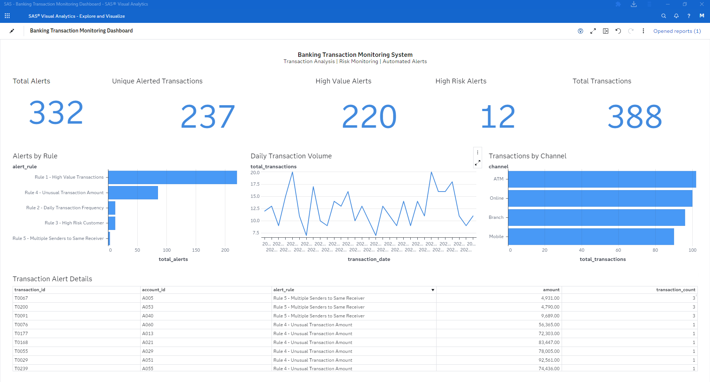
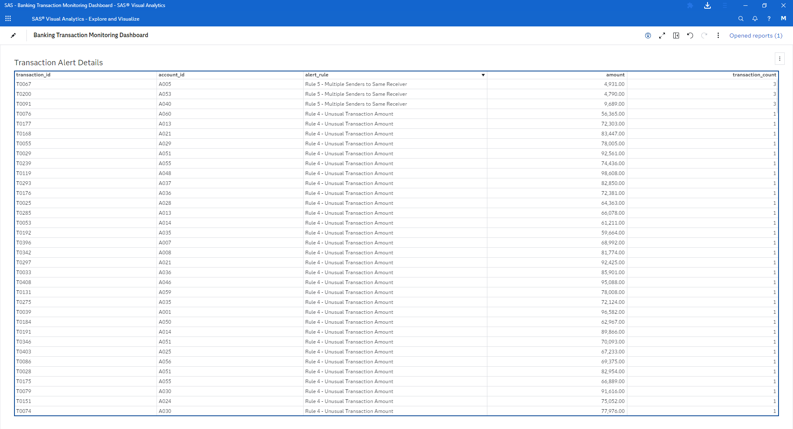

# Banking Transaction Monitoring | SAS

A learning project that simulates a basic banking transaction monitoring workflow using **SAS**. The project covers data creation, data quality assessment, cleaning, transformation, rule-based alert generation, KPI preparation, and loading analytical tables into **SAS Viya CAS** for reporting in **SAS Visual Analytics**.

> **Important – Educational Use Only:** All data used in this project is fictional / synthetic and was created for learning and demonstration purposes. It does not represent real customers, accounts, transactions, or any actual bank. The monitoring rules are illustrative examples, not production-grade AML controls, regulatory guidance, or a substitute for a bank's compliance framework.

## Project Overview

The goal is to demonstrate how a simple transaction monitoring pipeline can turn raw transaction data into structured, reviewable alerts and dashboard-ready datasets.

The workflow includes:

1. Creating sample customer, account, and transaction data.
2. Profiling the data and identifying common data quality issues.
3. Cleaning transaction records and validating account references.
4. Enriching transactions with customer and account attributes.
5. Creating derived fields and monthly summaries.
6. Applying rule-based monitoring scenarios to flag potentially unusual activity.
7. Generating dashboard KPIs and chart datasets.
8. Loading the prepared datasets into CAS for visualization.

## Tools & Technologies

- **SAS** – data preparation, transformation, SQL analysis, and rule-based monitoring.
- **PROC SQL** – joins, aggregations, validation, and alert generation.
- **SAS Viya / CAS** – in-memory data loading and promotion.
- **SAS Visual Analytics** – dashboarding and visual exploration.

## Project Structure

```text
Banking Transaction Monitoring/
│
├── 1_create_data_source.sas
├── 2_data_quality_assessment.sas
├── 3_data_cleaning.sas
├── 4_data_transformation.sas
├── 5_transaction_monitoring.sas
├── 6_generate_KPIS.sas
├── 7_generate_charts_data.sas
├── 8_load_insights_into_CAS.sas
├── etl_pipeline.sas
│
├── dashboard_overview.png
└── alert_details.png
```

## ETL & Analysis Workflow

### 1. Source Data Creation
Creates sample datasets for:
- Customers
- Accounts
- Transactions

### 2. Data Quality Assessment
Profiles the transaction data and checks for:
- Missing transaction amounts
- Negative transaction amounts
- Duplicate transaction IDs
- Invalid sender account references
- Invalid receiver account references

The script also creates a consolidated data quality issues table and a summary by issue type and severity.

### 3. Data Cleaning
- Removes duplicate transaction IDs.
- Separates records with missing or negative amounts into a rejected dataset.
- Keeps transactions whose sender and receiver accounts exist in the account table.

### 4. Data Transformation
- Enriches transactions with sender account and customer information.
- Derives transaction year, month, month name, and days since account opening.
- Categorizes transaction amounts as Small, Medium, or Large.
- Creates a monthly transaction summary by channel.

### 5. Rule-Based Transaction Monitoring

The project applies five illustrative monitoring rules:

| Rule | Description |
|---|---|
| High Value Transactions | Flags transactions with an amount greater than 10,000. |
| Daily Transaction Frequency | Flags sender accounts with at least 3 transactions on the same date. |
| High-Risk Customer | Flags transactions associated with customers categorized as High Risk. |
| Unusual Transaction Amount | Flags transactions with an amount greater than twice the overall average transaction amount. |
| Multiple Senders to Same Receiver | Flags receiver accounts receiving transactions from at least 3 distinct sender accounts on the same date. |

These rules are intentionally simple to demonstrate SAS logic and alert generation. Thresholds are configurable examples and should not be interpreted as validated fraud or money-laundering indicators.

### 6. KPI Generation
Prepares dashboard-level metrics, including:
- Total Alerts
- Total Transactions
- Unique Alerted Transactions
- High Value Alerts
- High-Risk Customer Alerts

### 7. Chart Dataset Preparation
Creates datasets for:
- Alerts by Rule
- Transactions by Channel
- Transactions Over Time

### 8. CAS Loading
Loads and promotes the dashboard and analysis tables into the `CASUSER` caslib for use in SAS Visual Analytics.

## Dashboard Preview

### Dashboard Overview



### Alert Details



## How to Run

1. Download or clone this repository.
2. Open the `.sas` files in a SAS environment.
3. Review the source data creation script and run the scripts in numerical order.
4. If using the master pipeline, open `etl_pipeline.sas` and set `project_path` to the folder containing the SAS scripts:

   ```sas
   %let project_path=/your/path/Banking Transaction Monitoring;
   ```

5. Run `etl_pipeline.sas`.

**Environment note:** The final CAS-loading script requires SAS Viya with an available CAS session and permission to use the `CASUSER` caslib. The dashboard itself is created in SAS Visual Analytics after the required tables are available in CAS. If you are using Base SAS without Viya/CAS, run scripts 1–7 and skip or adapt script 8.

## Notes & Limitations

- The dataset is synthetic and intentionally small; it is not representative of real banking transaction volumes or customer behavior.
- The monitoring scenarios are rule-based demonstrations. Real-world transaction monitoring requires carefully calibrated thresholds, customer context, time-window analysis, investigation workflows, and ongoing model/rule validation.
- A transaction can trigger more than one rule. Therefore, **Total Alerts** counts alert records/rule hits, while **Unique Alerted Transactions** counts distinct transaction IDs. These figures are not expected to be equal.
- The current unusual-amount rule uses a global average-based threshold. A production solution would require more robust segmentation and statistical validation.
- The current high-risk rule flags transactions linked to a high-risk customer; this is a review indicator, not proof that a transaction is suspicious.
- The master pipeline contains a configurable project path that must be updated before execution.

## What I Learned

Through this project, I practiced:
- Building a multi-step SAS ETL workflow.
- Profiling and cleaning structured data.
- Using PROC SQL for joins, aggregations, and validation.
- Creating derived variables and analytical summary tables.
- Translating simple business scenarios into monitoring rules.
- Preparing KPIs and chart datasets for a BI dashboard.
- Loading analytical tables into SAS Viya CAS.

## Disclaimer

This project is an independent educational exercise. It is not affiliated with, endorsed by, or based on the internal systems of any bank or financial institution. All names, identifiers, and transaction records are fictional.
